# Arduino Nano Robot Car (High-School Project, 2020)

A Bluetooth-controlled Arduino Nano robot car from a 2020 high-school project (自走車專題): programmed with motoBlockly blocks, driven from a phone app made in MIT App Inventor, and built on a 3D-printed chassis.

-00979D?logo=arduino&logoColor=white)


[English](#english) | [中文](#中文)

<p align="center">
  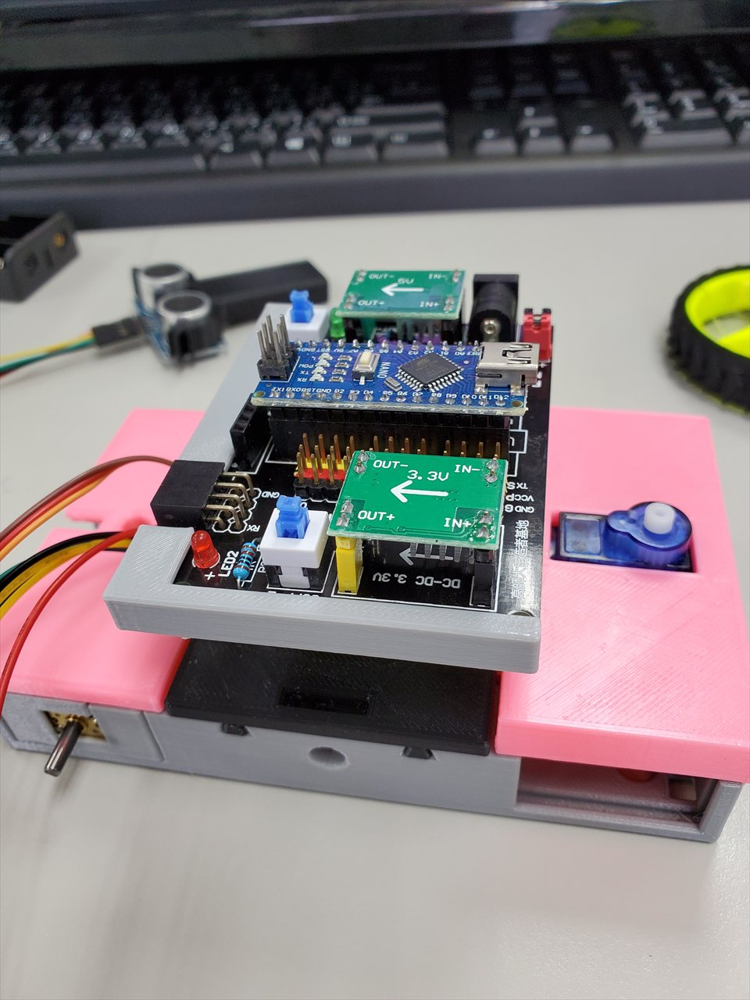
  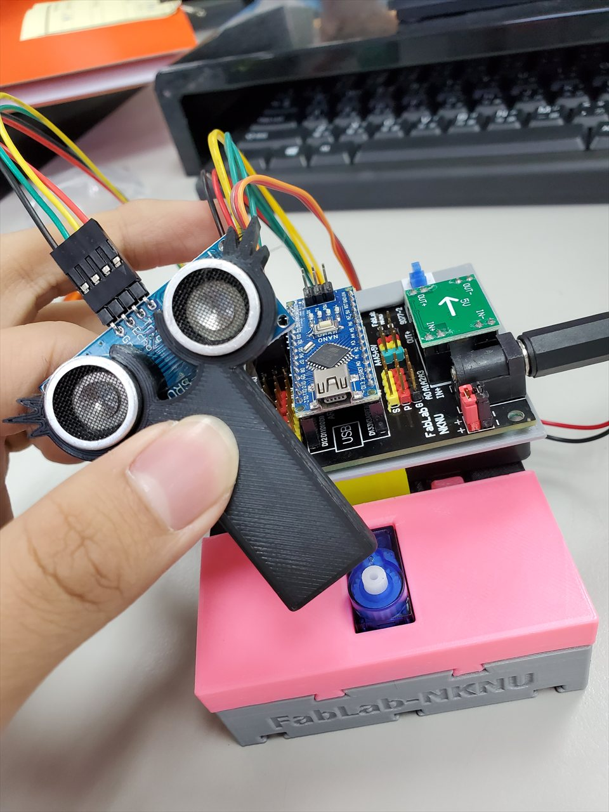
</p>

---

## English

### Overview

This repository archives the code, block programs, report figures and build photos from a spring-2020 high-school project. In it I learned to program an Arduino Nano and built a small two-wheeled robot car that is driven from a phone over Bluetooth. The final report is titled *4060 小車製作* ("Building the 4060 car"); 4060 is also the name of the course's controller board.

The saved programs show the learning path, step by step:

1. Digital output: lighting three outputs in sequence.
2. An RGB LED module driven with digital writes and with PWM fading.
3. A timed open-loop motor test: both wheels forward, both backward, then one wheel at a time to turn right and left.
4. **Final program, Bluetooth remote control:** a phone app sends one-letter commands (`W`, `S`, `A`, `D`, `F`) to a Bluetooth serial module, and the Nano drives the two motors forward, backward, right, left or stops.

Most programs were written in **motoBlockly**, a Blockly-based block editor that generates Arduino C++. The generated `.ino` files and a workspace export (`.xml`) are kept as they were. Three programs survive only as screenshots and were transcribed by hand (marked below).

> **Scope note:** the car also carries an HC-SR04 ultrasonic sensor on an SG90 servo mast. The report's retrospective says the ultrasonic program was not written because time ran out. The finished car is therefore remote-controlled only, and the sensor and servo are mounted but not used by the final program. No obstacle-avoidance or line-following code is claimed here.

### Hardware

The parts can be seen in the build photos (photo 03 is the annotated parts overview from the final report). The pin numbers come from the sketches.

| Part | Role | Pins used in code | Evidence |
|---|---|---|---|
| Arduino Nano (ATmega328P) | Main controller | – | photos 01, 06, 08 |
| "4060 WIFI" controller board (4060 WIFI 黑色電控板, FabLab NKNU) | Carrier for the Nano. It has a DC jack (7–12 V); 5 V and 3.3 V buck modules, each with a latching power switch (the 3.3 V rail feeds the Wi-Fi header); S/V/G headers for digital and analog I/O; an HC-06 Bluetooth header; a Wi-Fi module header; I²C headers; and two LEDs | – | photos 01, 03 (item 6) |
| Bluetooth serial module (HC-05/HC-06-style) | Receives the commands from the phone app | D0/D1 (hardware `Serial`, 9600 baud) | photo 03 (item 7) |
| L9110S dual-channel motor driver | Drives the two wheel motors | D2 + D3 (left motor), D4 + D5 (right motor) | photos 03 (item 3), 04 |
| 2 × micro metal gear motors | Wheel drive | via L9110S | photo 03 (item 2) |
| RGB LED module (R, G, B, GND) | Output exercises | D9, D10, D11 | photo 02 |
| 3 digital outputs on D11–D13 | First blink-sequence exercise | D11, D12, D13 | `led_sequence_blink.ino` |
| SG90 micro servo | Turns the sensor mast (mounted, not used by the final program) | – | photos 03 (item 4), 05, 07 |
| HC-SR04 ultrasonic sensor | Distance sensing (mounted, not used by the final program) | – | photos 03 (item 5), 07 |
| 2 × 18650 battery holder (3.7 V cells) | Power | – | photos 03 (item 8), 05 |
| 3D-printed chassis (FabLab-NKNU), two wheels, ball caster | Mechanics | – | photos 03 (item 1), 06, 07 |
| Phone with the control app | Remote control over Bluetooth | – | app blocks screenshot |

### Programs

| # | Sketch | Date | What it does | Origin |
|---|---|---|---|---|
| 1 | [`src/led_sequence_blink`](src/led_sequence_blink/led_sequence_blink.ino) | 2020-03-09 | Sets D13, D12 and D11 HIGH one after another, each for 2 s on and 1 s off, so one loop takes 9 s | Arduino IDE, adapted from the public-domain *Blink* example. The leftover Blink comments say "one second", but the real delays are 2 s / 1 s |
| 2 | [`src/rgb_led_color_cycle`](src/rgb_led_color_cycle/rgb_led_color_cycle.ino) | 2020-03-16 | Turns on exactly one of D9, D10 and D11 at a time for 2 s each, cycling the RGB LED through its three colours in a 6 s loop | motoBlockly-generated code, plus the block workspace export [`rgb_led_color_cycle.blocks.xml`](src/rgb_led_color_cycle/rgb_led_color_cycle.blocks.xml) |
| 3 | [`src/rgb_led_pwm_fade`](src/rgb_led_pwm_fade/rgb_led_pwm_fade.ino) | 2020-03-16 | Fades each channel (D9, then D10, then D11) up and down with `analogWrite`: 0 → 255 → 0 in steps of 5, 100 ms per step (about 5.2 s per ramp) with 1 s pauses, about 37 s per full loop | motoBlockly-generated code |
| 4 | [`src/rgb_traffic_light`](src/rgb_traffic_light/rgb_traffic_light.ino) | 2020-03-16 | D10 on for 20 s, then D9 and D10 on for 2 s, then D9 on for 15 s. With R on D9 and G on D10, that is green → yellow → red | **Transcribed by hand** from the block screenshot, because the generated code was not saved |
| 5 | [`src/motor_drive_test`](src/motor_drive_test/motor_drive_test.ino) | 2020-05-04 | Runs both motors forward for 10 s, stops for 2 s, runs both backward for 10 s, stops for 2 s, then runs only the left motor for 10 s (turns right) and only the right motor for 10 s (turns left), each followed by a 2 s stop. One loop takes 48 s | **Transcribed by hand** from the block screenshot, because the generated code was not saved |
| 6 | [`src/bluetooth_remote_control`](src/bluetooth_remote_control/bluetooth_remote_control.ino) | by 2020-07-03 (final report) | Reads one character from the Bluetooth serial link at 9600 baud: `W` forward, `S` backward, `D` right turn (left wheel only), `A` left turn (right wheel only), `F` stop. The last command stays active until the next one arrives | **Transcribed by hand** from the code screenshots in the final report; the block version is shown below |

#### Motor control logic (L9110S)

Each motor channel uses one digital pin and one PWM pin. The final program wraps this in `motorl(speed)` / `motorr(speed)`: for `speed > 0` it writes (`HIGH`, `255 − speed`), otherwise (`LOW`, `−speed`). `go(left, right)` sets both motors at once.

| Inputs (digital pin, PWM value) | Motor | Used by |
|---|---|---|
| `HIGH`, `0` | full speed forward | `W`: `go(255, 255)` |
| `LOW`, `255` | full speed backward | `S`: `go(-255, -255)` |
| `LOW`, `0` | stop | `F`: `go(0, 0)` |

The saved programs only use the speeds 0 and ±255, so the motors run at full speed or stop. Forward and backward are named after the `W`/`S` keys of the final program, and D2/D3 drive the left motor (`motorl`) there. A turn runs one wheel while the other is stopped, so the car swings around the stopped wheel instead of spinning in place.

#### Phone app (MIT App Inventor)

The control app, titled 藍芽車車控制 ("Bluetooth car control"), was built in MIT App Inventor. Its block program (screenshot below, from the final report) does the following:

- The direction buttons are disabled at start-up. A list picker shows the phone's paired Bluetooth devices; picking one connects to it, enables the buttons and shows "connected" (連線成功) or "device not found" (找不到藍芽裝置).
- Pressing the forward / backward / left / right button sends `W` / `S` / `A` / `D`, vibrates briefly and shows the direction in a status label (the backward handler shows 停, "stop", instead: a small bug in the original); releasing it sends `F` (stop).
- The disconnect button sends `F`, then closes the Bluetooth connection and resets the labels; another button exits the app.

### Results / Gallery

**Block programs (motoBlockly)**

| RGB colour cycle | RGB PWM fade | Traffic-light timing | Motor drive test |
|---|---|---|---|
| 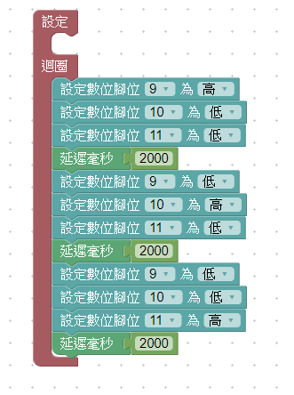 | 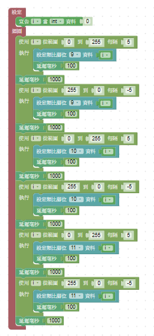 | 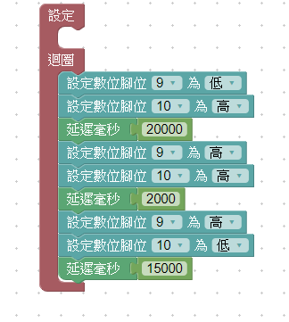 | 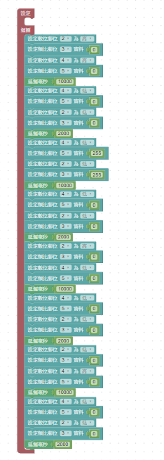 |

**Final program: Bluetooth remote control (motoBlockly)**

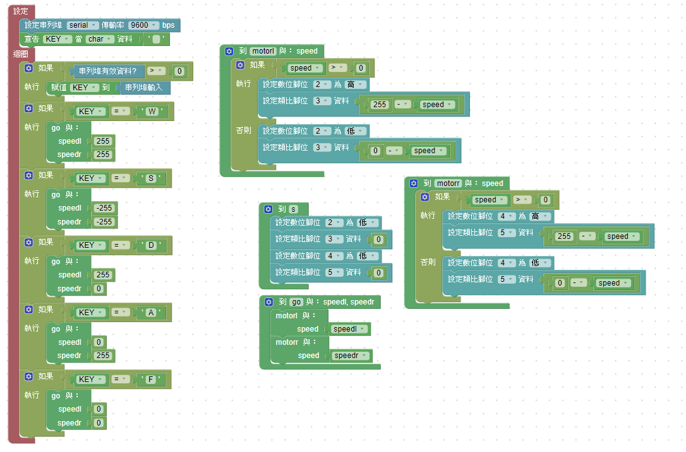

The generated code was captured as screenshots for programs 2, 3 and 6: [`rgb-color-cycle-code.png`](docs/images/blocks/rgb-color-cycle-code.png), [`rgb-pwm-fade-code.png`](docs/images/blocks/rgb-pwm-fade-code.png), [`bluetooth-remote-control-code-1.png`](docs/images/blocks/bluetooth-remote-control-code-1.png) and [`bluetooth-remote-control-code-2.png`](docs/images/blocks/bluetooth-remote-control-code-2.png).

**Phone app blocks (MIT App Inventor)**

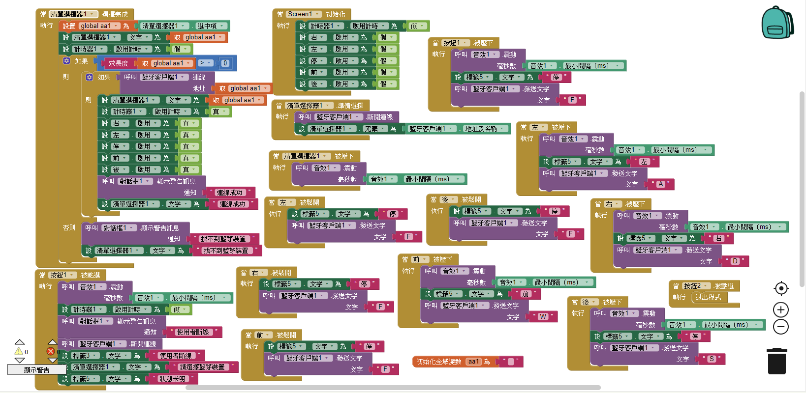

**Build photos**

| | | |
|---|---|---|
| 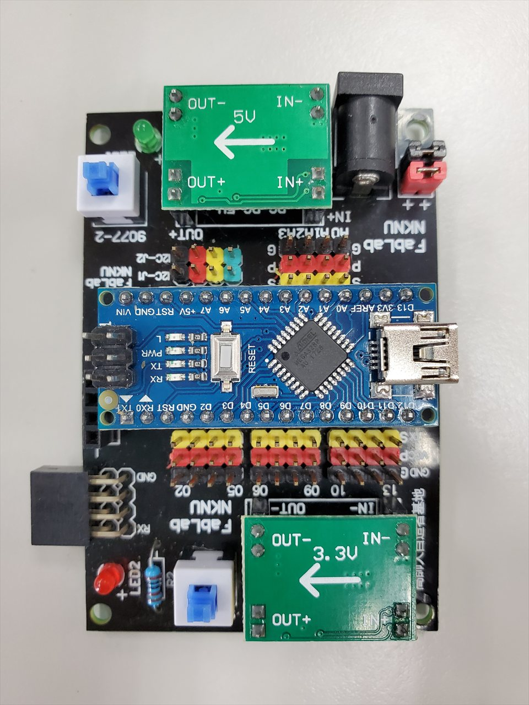<br>01 · Nano on the controller board (2020-03-09) | 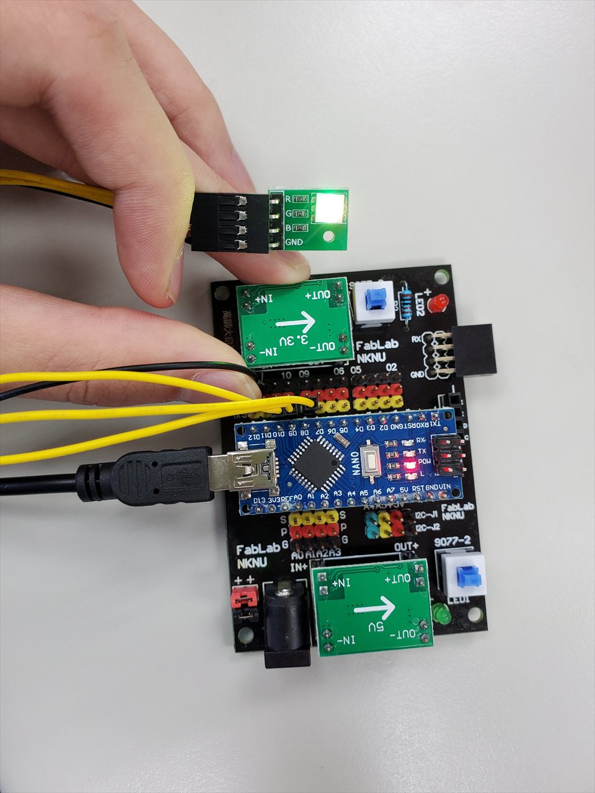<br>02 · RGB LED module test (2020-03-16) | 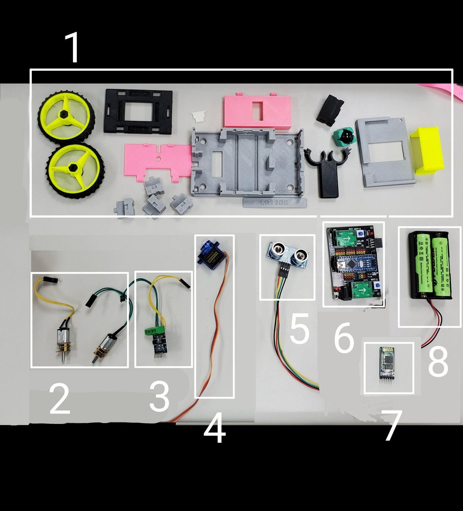<br>03 · Parts overview (from the final report) |
| 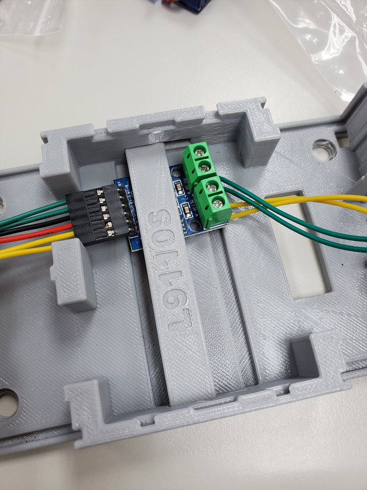<br>04 · L9110S motor driver in the chassis | 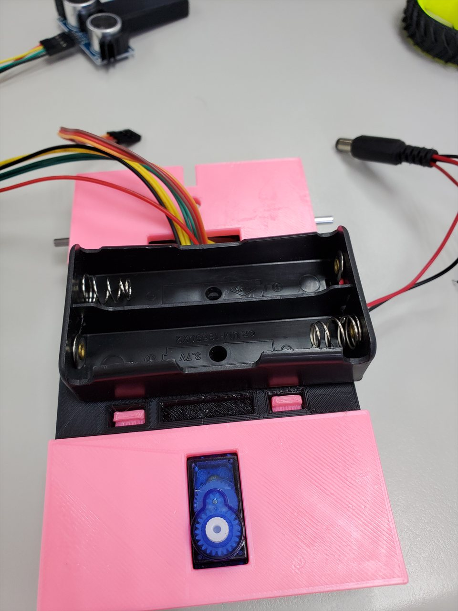<br>05 · 2 × 18650 holder and SG90 servo | <br>06 · Controller board stacked on the chassis |
| <br>07 · HC-SR04 sensor mast on the servo | 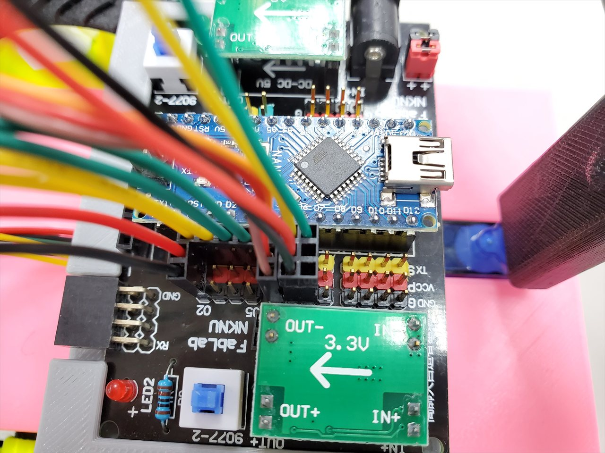<br>08 · Wiring to the Nano's I/O headers | |

Photo 03 legend: 1 chassis parts, 2 gear motors, 3 L9110S motor driver, 4 SG90 servo, 5 HC-SR04 ultrasonic module, 6 Nano + controller board, 7 Bluetooth module, 8 battery holder and cells. Photos 04–08 were taken on 2020-04-13. All photos were downscaled to 1280 px, and all EXIF/GPS metadata was removed.

### Build timeline

The dates come from photo timestamps and file dates in the project folder.

| Date | Milestone |
|---|---|
| 2020-03-09 | Introduction to the Arduino Nano, the controller board and the RGB LED module; first sketch (`led_sequence_blink`). |
| 2020-03-16 | Switched to motoBlockly: RGB colour cycle, PWM fade and traffic-light timing; RGB LED tested on the board (photo 02). |
| 2020-03-23 | Test videos recorded (not included). |
| 2020-03-30 | Class exercises photographed on screen (not included): read a joystick's X/Y (A0/A1) and button (D2), print the values over serial, and use the X value to drive D9, either mapped from 0–1023 to a 0–255 PWM value or as an on/off threshold. Test videos were also recorded. |
| 2020-04-13 | Car assembly: 3D-printed chassis, L9110S driver, gear motors, SG90 servo, HC-SR04 mast and battery holder, with the controller board stacked on top (photos 04–08). |
| 2020-04-20 | Class exercise photographed on screen (not included): sweep the SG90 servo back and forth and print its angle over serial. |
| 2020-04-27 | Class exercises photographed on screen (not included): HC-SR04 distance in cm with Trig on D7 and Echo on D8, and a speed-of-sound estimate (m/s) using a 30 cm reference distance. Test videos were also recorded. |
| 2020-05-04 | Timed two-motor drive test (`motor_drive_test`). |
| 2020-06-08 | Phone-app work in MIT App Inventor (the app's button-image assets are dated 2020-06-08). |
| 2020-07-03 | Final report and slides, *4060 小車製作*: Bluetooth remote-control program, phone app, and a demo video of the car being driven from the phone (report and video not included). |

### Retrospective (from the final report)

- Time ran out before the ultrasonic-sensor program could be written.
- The 3D-printed body was not sturdy enough.
- Remember to charge the car's batteries.

### Project structure

```
arduino-robot-car/
├── src/
│   ├── led_sequence_blink/
│   │   └── led_sequence_blink.ino
│   ├── rgb_led_color_cycle/
│   │   ├── rgb_led_color_cycle.ino
│   │   └── rgb_led_color_cycle.blocks.xml   # motoBlockly workspace export
│   ├── rgb_led_pwm_fade/
│   │   └── rgb_led_pwm_fade.ino
│   ├── rgb_traffic_light/
│   │   └── rgb_traffic_light.ino            # transcribed from screenshot
│   ├── motor_drive_test/
│   │   └── motor_drive_test.ino             # transcribed from screenshot
│   └── bluetooth_remote_control/
│       └── bluetooth_remote_control.ino     # final program, transcribed from report
├── docs/
│   └── images/
│       ├── app/       # MIT App Inventor blocks screenshot
│       ├── blocks/    # motoBlockly screenshots (block + generated code)
│       ├── photos/    # 8 build photos (1280 px, metadata stripped)
│       └── LICENSE.md # CC BY 4.0 for images
├── LICENSE            # MIT (code)
└── README.md
```

### Getting started

1. Install the [Arduino IDE](https://www.arduino.cc/en/software) (1.8.x or 2.x).
2. Open a sketch, for example `src/bluetooth_remote_control/bluetooth_remote_control.ino`. Each sketch sits in a folder with the same name, as the IDE expects.
3. Select **Tools → Board → Arduino Nano** and **Processor → ATmega328P**. Many Nano clones need **ATmega328P (Old Bootloader)**, and some also need a CH340 USB driver.
4. For the remote-control sketch, unplug the Bluetooth module first: it uses RX/TX (D0/D1), the same pins as the USB upload.
5. Select the serial port, then click **Upload**.
6. Wire the parts to match the pins in the [Programs](#programs) table. For the motor test, lift the car's wheels off the table first: it starts driving immediately and repeats every 48 s.
7. For the remote-control sketch, plug the Bluetooth module back in, pair the phone with it, and send `W`, `S`, `A`, `D` or `F` (the original App Inventor project is not included, but any Bluetooth serial terminal app can send these characters).

To view a block program, import `rgb_led_color_cycle.blocks.xml` into [motoBlockly](https://www.motoduino.com/motoblockly/).

### Tech stack

Arduino Nano (ATmega328P) · Arduino C++ · Arduino IDE · motoBlockly (Blockly-based) · MIT App Inventor · Bluetooth serial (UART, 9600 baud) · L9110S motor driver · PWM (`analogWrite`)

### Context

- High-school project course, 自走車專題 ("self-propelled car project"), spring 2020; the project files are dated March to July 2020.
- Author: Sheng-Wei Lu (呂聖韡), then a high-school student, now an M.S. student at the Graduate Institute of Space Systems Engineering, National Taipei University of Technology.

### Credits

- **motoBlockly** by Motoduino ([motoduino.com](https://www.motoduino.com/motoblockly/)) generated sketches 2, 3 and 6 and the block screenshots; the generator header is kept in sketches 2 and 3.
- The phone app was built with **MIT App Inventor**. Its arrow-button images came from a third-party stock image and are not included.
- `led_sequence_blink.ino` is adapted from the Arduino **Blink** example (public domain; by Scott Fitzgerald, Arturo Guadalupi and Colby Newman). The original header is kept.
- The controller board and 3D-printed chassis parts carry **FabLab NKNU** branding. They are course-kit hardware, not my designs.
- Course handouts, lecture slides and videos are not included. The final report itself is not included either; only the figures listed above are taken from it.

### License

- Code (`src/`): [MIT](LICENSE) © 2020–2026 Sheng-Wei Lu.
- Photos and screenshots (`docs/images/`): [CC BY 4.0](docs/images/LICENSE.md).

---

## 中文

### 專案簡介

本儲存庫整理了我高中「自走車專題」（2020 年春季）的程式、圖形化積木程式、報告圖片與實作照片。在這個專題裡，我從零開始學 Arduino Nano 程式設計，並組裝了一台可以用手機透過藍牙遙控的雙輪小車。期末報告題目為《4060 小車製作》；「4060」也是課程所用電控板的名稱。

保存下來的程式依序呈現學習進度：

1. 數位輸出：依序點亮三個腳位。
2. 用數位輸出和 PWM 漸變控制 RGB LED 模組。
3. 以固定時間控制兩顆馬達的開迴路行走測試：前進、後退，再以單輪驅動左右轉向。
4. **最終程式：藍牙遙控。** 手機 App 透過藍牙序列模組送出單一字母指令（`W`、`S`、`A`、`D`、`F`），Nano 依指令讓兩顆馬達前進、後退、右轉、左轉或停止。

大部分程式用 **motoBlockly**（以 Blockly 為基礎、可產生 Arduino C++ 的積木編輯器）撰寫。自動產生的 `.ino` 與積木工作區匯出檔（`.xml`）都保留原樣。其中三個程式只留下截圖，是手動轉寫的（下表有標示）。

> **範圍說明：** 小車上還裝了架在 SG90 伺服馬達上的 HC-SR04 超音波感測器。不過報告的檢討提到，因為時間沒有拿捏好，來不及寫超音波的程式。所以完成的小車只有遙控功能，感測器與伺服馬達雖然有裝上，最終程式並沒有用到。本專案不宣稱有避障或循跡功能。

### 硬體

以下零件都能在實作照片中看到（照片 03 是期末報告裡的零件總覽標註圖），腳位則取自程式碼。

| 零件 | 用途 | 程式使用腳位 | 依據 |
|---|---|---|---|
| Arduino Nano（ATmega328P） | 主控板 | – | 照片 01、06、08 |
| 「4060 WIFI 黑色電控板」（FabLab NKNU） | Nano 擴充底板。具 DC 電源座（7–12 V）；5 V 與 3.3 V 降壓模組，各有一個自鎖式電源開關（3.3 V 供 WiFi 接口使用）；數位與類比 I/O 的 S/V/G 排針；HC-06 藍牙接口；WiFi 模組接口；I²C 接口；以及兩顆 LED | – | 照片 01、03（項目 6） |
| 藍牙序列模組（HC-05/HC-06 類型） | 接收手機 App 傳來的指令 | D0/D1（硬體 `Serial`，9600 baud） | 照片 03（項目 7） |
| L9110S 雙路馬達驅動板 | 驅動兩顆輪子馬達 | D2 + D3（左馬達）、D4 + D5（右馬達） | 照片 03（項目 3）、04 |
| 微型金屬減速馬達 × 2 | 輪子驅動 | 經 L9110S | 照片 03（項目 2） |
| RGB LED 模組（R、G、B、GND） | 輸出練習 | D9、D10、D11 | 照片 02 |
| D11–D13 三路數位輸出 | 第一個依序閃爍練習 | D11、D12、D13 | `led_sequence_blink.ino` |
| SG90 小型伺服馬達 | 轉動感測器支架（已安裝，最終程式未使用） | – | 照片 03（項目 4）、05、07 |
| HC-SR04 超音波感測器 | 距離偵測（已安裝，最終程式未使用） | – | 照片 03（項目 5）、07 |
| 18650 × 2 電池盒（3.7 V 電池） | 電源 | – | 照片 03（項目 8）、05 |
| 3D 列印車體（FabLab-NKNU）、兩顆輪子、萬向球輪 | 機構 | – | 照片 03（項目 1）、06、07 |
| 安裝控制 App 的手機 | 藍牙遙控 | – | App 積木截圖 |

### 程式說明

| # | 程式 | 日期 | 功能 | 來源 |
|---|---|---|---|---|
| 1 | [`src/led_sequence_blink`](src/led_sequence_blink/led_sequence_blink.ino) | 2020-03-09 | D13、D12、D11 依序拉高，各亮 2 秒、暗 1 秒，一輪 9 秒 | Arduino IDE，改寫自公有領域的 *Blink* 範例。程式中殘留的 Blink 註解寫「一秒」，但實際延遲是 2 秒／1 秒 |
| 2 | [`src/rgb_led_color_cycle`](src/rgb_led_color_cycle/rgb_led_color_cycle.ino) | 2020-03-16 | D9、D10、D11 每次只亮一個，各 2 秒，讓 RGB LED 輪流顯示三種顏色，一輪 6 秒 | motoBlockly 產生的程式，另附積木匯出檔 [`rgb_led_color_cycle.blocks.xml`](src/rgb_led_color_cycle/rgb_led_color_cycle.blocks.xml) |
| 3 | [`src/rgb_led_pwm_fade`](src/rgb_led_pwm_fade/rgb_led_pwm_fade.ino) | 2020-03-16 | 依序對 D9、D10、D11 用 `analogWrite` 做漸亮漸暗：0 → 255 → 0，每步加減 5、間隔 100 ms（每段約 5.2 秒），中間停 1 秒，一輪約 37 秒 | motoBlockly 產生的程式 |
| 4 | [`src/rgb_traffic_light`](src/rgb_traffic_light/rgb_traffic_light.ino) | 2020-03-16 | D10 亮 20 秒，接著 D9 和 D10 同時亮 2 秒，再來 D9 亮 15 秒。若 R 接 D9、G 接 D10，就是綠 → 黃 → 紅 | 原始產生碼未保存，依積木截圖**手動轉寫** |
| 5 | [`src/motor_drive_test`](src/motor_drive_test/motor_drive_test.ino) | 2020-05-04 | 兩顆馬達前進 10 秒、停 2 秒，再後退 10 秒、停 2 秒；接著只轉左馬達 10 秒（右轉）、只轉右馬達 10 秒（左轉），每段後各停 2 秒。一輪 48 秒 | 原始產生碼未保存，依積木截圖**手動轉寫** |
| 6 | [`src/bluetooth_remote_control`](src/bluetooth_remote_control/bluetooth_remote_control.ino) | 2020-07-03 前（期末報告） | 以 9600 baud 從藍牙序列埠讀取一個字元：`W` 前進、`S` 後退、`D` 右轉（只轉左輪）、`A` 左轉（只轉右輪）、`F` 停止。收到下一個指令前，會一直維持上一個指令 | 依期末報告中的程式碼截圖**手動轉寫**；積木版本見下方 |

#### 馬達控制邏輯（L9110S）

每一路馬達用一支數位腳加一支 PWM 腳控制。最終程式把它包成 `motorl(speed)`／`motorr(speed)`：`speed > 0` 時輸出（`HIGH`, `255 − speed`），否則輸出（`LOW`, `−speed`）；`go(left, right)` 則同時設定兩顆馬達。

| 輸入（數位腳, PWM 值） | 馬達狀態 | 對應指令 |
|---|---|---|
| `HIGH`, `0` | 全速前進 | `W`：`go(255, 255)` |
| `LOW`, `255` | 全速後退 | `S`：`go(-255, -255)` |
| `LOW`, `0` | 停止 | `F`：`go(0, 0)` |

保存下來的程式只用到速度 0 與 ±255，所以馬達只有全速和停止兩種狀態。「前進／後退」依最終程式的 `W`／`S` 鍵命名，該程式中 D2/D3 驅動的是左馬達（`motorl`）。轉彎時只轉一個輪子、另一輪停止，所以小車是繞著停住的輪子轉，而不是原地旋轉。

#### 手機 App（MIT App Inventor）

控制 App 名為「藍芽車車控制」，用 MIT App Inventor 製作。它的積木程式（下方截圖，取自期末報告）功能如下：

- 啟動時方向按鈕為停用狀態。清單選擇器會列出手機已配對的藍牙裝置；選定後即連線、啟用按鈕，並顯示「連線成功」或「找不到藍芽裝置」。
- 按下前／後／左／右按鈕時送出 `W`／`S`／`A`／`D`，同時短暫震動並在狀態標籤顯示方向（原程式的「後」按鈕誤顯示為「停」）；放開按鈕時送出 `F`（停止）。
- 中斷連線按鈕會先送出 `F`，再中斷藍牙連線並重設標籤；另一個按鈕用來結束 App。

### 成果與照片

**積木程式（motoBlockly）**

| RGB 顏色循環 | RGB PWM 漸變 | 紅綠燈時序 | 馬達行走測試 |
|---|---|---|---|
|  |  |  |  |

**最終程式：藍牙遙控（motoBlockly）**


程式 2、3、6 由積木產生的程式碼也有截圖：[`rgb-color-cycle-code.png`](docs/images/blocks/rgb-color-cycle-code.png)、[`rgb-pwm-fade-code.png`](docs/images/blocks/rgb-pwm-fade-code.png)、[`bluetooth-remote-control-code-1.png`](docs/images/blocks/bluetooth-remote-control-code-1.png)、[`bluetooth-remote-control-code-2.png`](docs/images/blocks/bluetooth-remote-control-code-2.png)。

**手機 App 積木（MIT App Inventor）**


**實作照片**

| | | |
|---|---|---|
| <br>01 · 電控板上的 Nano（2020-03-09） | <br>02 · RGB LED 模組測試（2020-03-16） | <br>03 · 零件總覽（取自期末報告） |
| <br>04 · 車體內的 L9110S 馬達驅動板 | <br>05 · 18650 × 2 電池盒與 SG90 伺服馬達 | <br>06 · 疊在車體上的電控板 |
| <br>07 · 伺服馬達上的超音波感測器支架 | <br>08 · Nano 排針接線特寫 | |

照片 03 標號：1 車體零件、2 減速馬達、3 L9110S 馬達驅動板、4 SG90 伺服馬達、5 HC-SR04 超音波模組、6 Nano + 電控板、7 藍牙模組、8 電池盒與電池。照片 04–08 攝於 2020-04-13。所有照片都已縮小到 1280 px，並移除 EXIF/GPS 中繼資料。

### 製作時程

日期取自專題資料夾中的照片拍攝時間與檔案日期。

| 日期 | 進度 |
|---|---|
| 2020-03-09 | 認識 Arduino Nano、電控板與 RGB LED 模組；第一個程式（`led_sequence_blink`）。 |
| 2020-03-16 | 改用 motoBlockly：RGB 顏色循環、PWM 漸變、紅綠燈時序；在電控板上測試 RGB LED（照片 02）。 |
| 2020-03-23 | 錄製測試影片（未收錄）。 |
| 2020-03-30 | 課堂練習（螢幕照片，未收錄）：讀取搖桿 X/Y（A0/A1）與按鍵（D2）並由序列埠印出，再用 X 值控制 D9：把 0–1023 對應成 0–255 的 PWM 值，或用門檻值切換開關。另錄有測試影片。 |
| 2020-04-13 | 組裝小車：3D 列印車體、L9110S 驅動板、減速馬達、SG90 伺服馬達、超音波感測器支架與電池盒，電控板疊在最上層（照片 04–08）。 |
| 2020-04-20 | 課堂練習（螢幕照片，未收錄）：讓 SG90 伺服馬達來回擺動，並以序列埠印出角度。 |
| 2020-04-27 | 課堂練習（螢幕照片，未收錄）：用 HC-SR04 量測距離（公分，Trig 接 D7、Echo 接 D8），並以 30 公分的參考距離估算音速（m/s）。另錄有測試影片。 |
| 2020-05-04 | 雙馬達定時行走測試（`motor_drive_test`）。 |
| 2020-06-08 | 用 MIT App Inventor 製作手機 App（App 的按鈕圖片素材日期為 2020-06-08）。 |
| 2020-07-03 | 期末報告與簡報《4060 小車製作》：藍牙遙控程式、手機 App，以及用手機操控小車的成果影片（報告與影片未收錄）。 |

### 事後檢討（摘自期末報告）

- 時間沒有拿捏好，來不及寫超音波感測器的程式。
- 用 3D 建模列印的車身不夠堅固。
- 車用電池要記得充電。

### 專案結構

```
arduino-robot-car/
├── src/
│   ├── led_sequence_blink/
│   │   └── led_sequence_blink.ino            # D11–D13 依序閃爍
│   ├── rgb_led_color_cycle/
│   │   ├── rgb_led_color_cycle.ino           # RGB 顏色循環
│   │   └── rgb_led_color_cycle.blocks.xml    # motoBlockly 積木匯出檔
│   ├── rgb_led_pwm_fade/
│   │   └── rgb_led_pwm_fade.ino              # RGB PWM 漸變
│   ├── rgb_traffic_light/
│   │   └── rgb_traffic_light.ino             # 紅綠燈時序（依截圖轉寫）
│   ├── motor_drive_test/
│   │   └── motor_drive_test.ino              # 雙馬達行走測試（依截圖轉寫）
│   └── bluetooth_remote_control/
│       └── bluetooth_remote_control.ino      # 最終程式：藍牙遙控（依報告轉寫）
├── docs/
│   └── images/
│       ├── app/       # MIT App Inventor 積木截圖
│       ├── blocks/    # motoBlockly 積木與產生碼截圖
│       ├── photos/    # 8 張實作照片（1280 px，已移除中繼資料）
│       └── LICENSE.md # 圖片採 CC BY 4.0
├── LICENSE            # MIT（程式碼）
└── README.md
```

### 使用方式

1. 安裝 [Arduino IDE](https://www.arduino.cc/en/software)（1.8.x 或 2.x）。
2. 開啟要上傳的程式，例如 `src/bluetooth_remote_control/bluetooth_remote_control.ino`。每個程式都放在同名資料夾中，符合 IDE 的要求。
3. 選擇 **工具 → 開發板 → Arduino Nano**，**處理器 → ATmega328P**。許多 Nano 副廠板要改選 **ATmega328P (Old Bootloader)**，有些還需要安裝 CH340 USB 驅動程式。
4. 上傳藍牙遙控程式前，請先拔下藍牙模組：它使用 RX/TX（D0/D1），和 USB 上傳共用同一組腳位。
5. 選擇序列埠後按 **上傳**。
6. 依照[程式說明](#程式說明)表中的腳位接線。執行馬達測試前請先把車輪架空：程式上傳後會立刻開始行走，每 48 秒重複一次。
7. 使用藍牙遙控程式時，把藍牙模組插回去、讓手機與模組配對，再送出 `W`、`S`、`A`、`D` 或 `F`。原本的 App Inventor 專案沒有收錄，但任何藍牙序列埠終端機 App 都能送出這些字元。

想看積木版本時，可以把 `rgb_led_color_cycle.blocks.xml` 匯入 [motoBlockly](https://www.motoduino.com/motoblockly/)。

### 使用技術

Arduino Nano（ATmega328P）· Arduino C++ · Arduino IDE · motoBlockly（Blockly 積木）· MIT App Inventor · 藍牙序列傳輸（UART，9600 baud）· L9110S 馬達驅動 · PWM（`analogWrite`）

### 背景

- 高中專題課程：自走車專題，2020 年春季；專題檔案日期為 2020 年 3 月至 7 月。
- 作者：呂聖韡（Sheng-Wei Lu），當時為高中生；現就讀國立臺北科技大學太空系統工程研究所。

### 致謝與來源

- **motoBlockly**（Motoduino，[motoduino.com](https://www.motoduino.com/motoblockly/)）：產生程式 2、3、6 與積木截圖；程式 2、3 保留其產生器標頭。
- 手機 App 以 **MIT App Inventor** 製作。App 的方向按鈕圖片取自第三方圖庫，未收錄。
- `led_sequence_blink.ino` 改寫自 Arduino **Blink** 範例（公有領域；作者 Scott Fitzgerald、Arturo Guadalupi、Colby Newman），保留原始標頭。
- 電控板與 3D 列印車體零件印有 **FabLab NKNU** 標示，屬於課程套件硬體，不是我的設計。
- 課程講義、投影片與影片均未收錄。期末報告本身也未收錄，只取用上面列出的圖片。

### 授權

- 程式碼（`src/`）：[MIT](LICENSE) © 2020–2026 Sheng-Wei Lu。
- 照片與截圖（`docs/images/`）：[CC BY 4.0](docs/images/LICENSE.md)。
